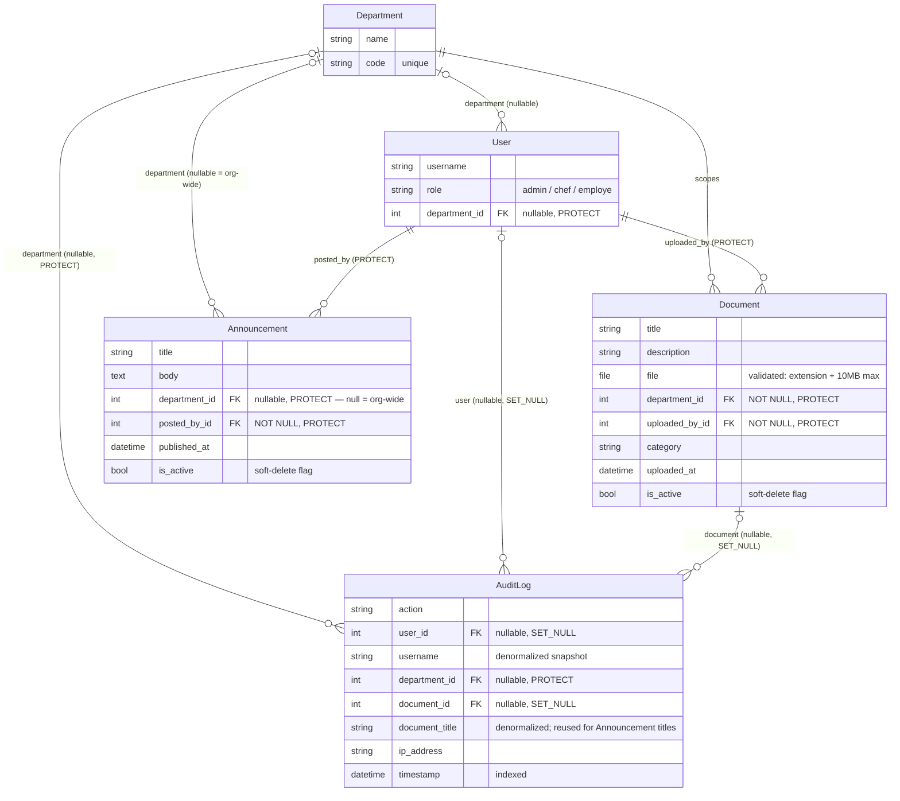
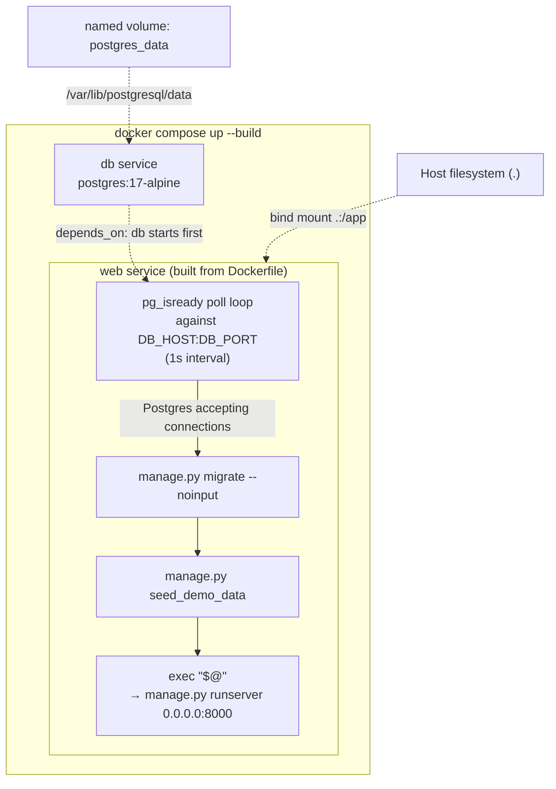

# Architecture

Design rationale, data model, and known limitations for the Intranet DGH portal. For setup and quickstart, see the [README](../README.md).

## Table of Contents

1. [Overview](#overview)
2. [Architecture Decision Records](#architecture-decision-records)
   - [ADR-0001: Monolith, no separate API layer](#adr-0001-monolith-no-separate-api-layer)
   - [ADR-0002: SQLite (dev) → PostgreSQL (prod)](#adr-0002-sqlite-dev--postgresql-prod)
3. [Data Model](#data-model)
4. [RBAC](#rbac)
5. [Two-Layer Permission Enforcement Pattern](#two-layer-permission-enforcement-pattern)
6. [Audit Log Design](#audit-log-design)
7. [Docker Architecture](#docker-architecture)
8. [Known Limitations](#known-limitations)
9. [Explicitly Out of Scope](#explicitly-out-of-scope)

## Overview

This project deliberately targets a small, correctly-architected slice of an intranet portal — authentication, RBAC, document management, announcements, and audit logging — rather than shallow breadth across many half-built features. As a PFA evaluated by a jury, the goal is to demonstrate sound reasoning behind every scope boundary, not to maximize feature count. See the [README](../README.md) for how to get the project running locally.

## Architecture Decision Records

### ADR-0001: Monolith, no separate API layer

**Decision:** Server-rendered Django templates + Bootstrap 5, no Django REST Framework, no separate JS frontend, no JSON API surface.

**Why:** There is no mobile client, third-party integration, or separate frontend team that needs programmatic access — the only consumer of this application is a browser rendering HTML. Building a DRF API (serializers, a second auth story, versioning) alongside server-rendered views would double the surface area for a solo developer on a 3-week timeline without a corresponding requirement to justify it. A monolith with server-rendered templates is the simplest thing that satisfies every actual requirement.

**Revisit when:** A mobile app, a third-party system needing programmatic access, or a move to a JS-framework frontend creates a real need for JSON endpoints. None of these exist today.

### ADR-0002: SQLite (dev) → PostgreSQL (prod)

**Decision:** `DATABASES` is configured field-by-field via environment variables (`DB_ENGINE`, `DB_NAME`, `DB_USER`, `DB_PASSWORD`, `DB_HOST`, `DB_PORT`) in `dgh_intranet/settings/base.py`, rather than a `DATABASE_URL` shortcut. SQLite is the zero-install default for local development; PostgreSQL is used in Docker and is the intended production database.

**Why:** Env-var-driven config means switching engines is a `.env` (or Compose `environment:`) edit, not a settings-file rewrite. No SQLite-specific behavior is relied on anywhere in the codebase.

**Status: verified, not just designed.** As of **2026-08-07**, the full test suite (**41/41 tests**) was run via `docker compose exec web python manage.py test accounts documents core` against a real `postgres:17-alpine` container, not SQLite. This is a materially stronger claim than "the config is designed to allow this" — the app has actually been exercised against Postgres, including migrations, and passed.

## Data Model

Notes on `on_delete` choices, matching the real models:

- `User.department` and `Announcement.department` are **nullable** — `None` on `User` means an Admin with no department; `None` on `Announcement` means org-wide, not "unset."
- `Document.department` is **non-nullable** — every document belongs to exactly one department.
- `AuditLog.user` and `AuditLog.document` use `SET_NULL` — deleting a user or a document must not delete history that references them.
- Every other FK to `Department` (`User`, `Document`, `Announcement`, `AuditLog`) uses `PROTECT` — a Department cannot be deleted while anything still references it, favoring a blocked delete over silently orphaned rows.

## RBAC

Three roles: **Admin**, **Chef de Département**, **Employé** — implemented as an explicit `role` `CharField` on the custom `User` model, not Django's built-in Groups.

**Why not Groups:** Django's permission system (including Groups) is model-level only — it can answer "can this user edit Documents in general," but not "can this user edit *this* Document, because it's in their department." Department-scoped, object-level visibility is the entire point of this app's access control, so Groups would only ever solve half the problem. An explicit `role` field is also more legible in application code than matching against Group names. Admins are additionally flagged `is_staff=True, is_superuser=True` to get Django admin panel access — Groups still appear (empty, unused) in that admin UI because `django.contrib.auth` ships them by default, not because they're part of this app's design.

## Two-Layer Permission Enforcement Pattern

Every view touching `Document` or `Announcement` answers two separate questions, deliberately kept as two separate mechanisms rather than one combined check:

1. **Can this user act at all?** — `RoleRequiredMixin` (`accounts/mixins.py`), a role-gate applied per-view (e.g. `DocumentUploadView.allowed_roles = ["chef"]`, `AuditLogListView.allowed_roles = ["chef"]`).
2. **Which objects can this specific user see?** — `visible_to(user)`, a queryset method on `Document`/`Announcement` (`core/models.py`, `documents/models.py`) that filters by department and excludes soft-deleted rows. `AuditLogListView` (`audit/views.py`) applies the same second question inline rather than via a `visible_to()` method — `get_queryset()` filters `AuditLog.objects.filter(department=self.request.user.department)` directly — since `AuditLog` has no soft-delete state to also exclude, a full queryset method would just wrap a single `.filter()` call.

These stay separate because they answer genuinely different questions: role is a property of the user, independent of any object; visibility is a property of the (user, object) pair. Collapsing them into one check tends to produce exactly the kind of bug this project actually hit:

> `RoleRequiredMixin` originally checked `request.user.role` **before** confirming the user was authenticated. An anonymous request has no meaningful `role`, so this raised an unhandled error and returned an HTTP 500 instead of a clean redirect to the login page — the opposite of the intended behavior for an unauthenticated visitor.

The fix reordered the check (`dispatch()` now checks `is_authenticated` first, falling back to `handle_no_permission()`, and only then checks `role`) and is covered by a dedicated regression test: `accounts/tests.py::AuthTests::test_anonymous_hitting_role_required_view_redirects_to_login_not_500`. This is the concrete argument for keeping "can act at all" and "which objects are visible" as two distinct, independently testable mechanisms rather than one entangled check.

## Audit Log Design

**Immutability is enforced in code**, not just documented as a policy: `AuditLog.save()` raises `ValidationError` if `self.pk` is already set (blocking edits), and `AuditLog.delete()` unconditionally raises `ValidationError` (`audit/models.py`). This was verified directly in a Django shell session — attempting to mutate or delete an existing entry raises immediately, rather than relying on convention or UI omission alone — and is now also test-covered: `AuditLogImmutabilityTests` (`audit/tests.py`, 3 tests) asserts `save()` on an existing entry raises `ValidationError`, `delete()` raises `ValidationError`, and the row still exists in the database after both blocked attempts.

**Two different write paths, deliberately:**

- **Auth events** (`login_success`, `login_failed`, `logout`) are written via Django's built-in auth signals (`audit/signals.py`, listening on `user_logged_in` / `user_logged_out` / `user_login_failed`), because Django already emits exactly the right signal at exactly the right moment for these events and there's no model write to hook into instead.
- **Document/announcement events** (`document_upload`, `document_download`, `document_delete`, `announcement_create`, `announcement_delete`) are written via explicit `log_action(...)` calls at the call sites in `documents/views.py` and `core/views.py`, not via a generic `post_save`/`post_delete` signal.

**Why explicit calls instead of a generic signal for the model events:** a `post_save` signal fires identically for "a document was just uploaded" and "a document's title was just edited" — it has no way to distinguish those without extra bookkeeping, yet only the former should produce a `document_upload` entry. Soft-delete makes this worse: setting `is_active=False` is itself a `save()`, indistinguishable from any other field edit at the signal level. And downloads never write to the `Document` row at all — `document_download` has no model event to hook into in the first place, since `FileResponse` streams the file without touching the database. Explicit `log_action()` calls at each meaningful action avoid all three problems at once.

**No-fallback department rule:** `log_action()` (`audit/services.py`) takes `announcement.department` as-is when logging an announcement event — including `None` for an org-wide announcement — and never substitutes the posting user's department instead. Falling back to `resolved_user.department` would misrepresent an org-wide announcement as belonging to the poster's department in the audit trail. The fallback to `resolved_user.department` only applies when there's no document *and* no announcement at all.

## Docker Architecture

`entrypoint.sh` is the container's actual startup sequence: poll `pg_isready` once per second until Postgres accepts connections, then `migrate --noinput`, then `seed_demo_data` (idempotent, safe on every restart), then `exec "$@"` to hand off to the image's `CMD`. `depends_on: db` in `docker-compose.yml` only orders container *startup*, not Postgres *readiness* — the wait loop in `entrypoint.sh` is what actually makes `web` safe to start migrating against.

`web` bind-mounts the repo root (`.:/app`), which serves two purposes: uploaded files under `media/` persist on the host across container restarts, and local code edits are reflected live without rebuilding the image. `db` uses a named volume (`postgres_data`) instead, since Postgres's data directory has no reason to be host-visible or human-edited.

## Known Limitations

| Limitation | Notes |
|---|---|
| Django's built-in validator error messages are untranslated | `USE_I18N = False` (deliberate, French-only UI) also disables Django's own translations for things like password-validator messages; these need explicit manual French overrides that don't happen automatically. |
| Django admin UI chrome is untranslated | Same root cause as above — admin panel labels/messages outside this app's own `verbose_name`s render in English. |
| `AuditLog.document_title` is reused for Announcement titles | There's no separate FK/field for announcements; `log_action()` stores the announcement's title in the same `document_title` column as document titles, distinguished only by `action` and the absence of a `document` FK. |
| No in-portal audit log visibility for Employé | Chef de Département now has an in-portal audit view (`audit/views.py::AuditLogListView`, gated `allowed_roles = ["chef"]`, `audit/urls.py`, nav link in `templates/base.html` gated on `user.role == "chef"`), scoped to their own department — matching `docs/permission-matrix.md`'s original plan. Added 2026-08-07, covered by `AuditLogListViewTests` (4 tests: own-department visibility, cross-department exclusion, Employé 403, anonymous redirect). Employé still has no audit visibility at all, which remains the deliberate part of the original design — only Admin (via `/admin/`) and Chef (via this view, department-scoped) can see audit entries. |
| Admin cannot upload documents via the portal | `DocumentUploadView.allowed_roles = ["chef"]` only — Admin's document access is view/download plus deletion, not upload, through the portal UI. Admin can still add rows via `/admin/` directly. |
| `.env`'s `SECRET_KEY` is a dev-only local value | It must be regenerated before any real deployment; it is gitignored but was never meant to be a production secret. |
| `prod.py` is configured but never deployed | Hardened settings exist (`DEBUG=False`, HSTS, secure cookies, `SECURE_PROXY_SSL_HEADER`) and pass `manage.py check --deploy`, but this project has only ever actually run via `runserver`/Docker `web`, never behind a real WSGI server + reverse proxy. |
| Bind-mount executable bit on Windows | `Dockerfile` does `chmod +x entrypoint.sh` at build time, but `web`'s `.:/app` bind mount overlays that with the host copy at runtime. Docker Desktop's WSL2 backend forced a working executable bit on this machine, but that behavior is a property of the Docker Desktop backend, not a guarantee of bind mounts in general — this is a caveat to watch for on a different machine/backend, not a problem that's been solved. |

## Explicitly Out of Scope

- **Workflow/approval engines** — no document or announcement in this app goes through a multi-step approval chain; every write is immediate, subject only to the RBAC checks above. Out of scope because nothing in the brief calls for staged approvals, and building one would be speculative complexity for a 3-week PFA.
- **Real email integration** — password reset uses Django's console email backend in dev; there is no SMTP/transactional provider wired up. Out of scope because provisioning real email delivery is an infrastructure decision independent of this app's logic, not a missing feature of the app itself.
- **Advanced search/analytics** — there is no full-text search, filtering beyond department/category, or reporting dashboard. Out of scope because the core evaluation criteria are RBAC and data integrity, not information retrieval.
- **Mobile-responsive polish beyond "looks decent"** — Bootstrap 5's default responsive grid is relied on as-is; no custom breakpoints or mobile-specific layouts were built. Out of scope because this is a desktop-first internal tool, not a public-facing or mobile-first product.
